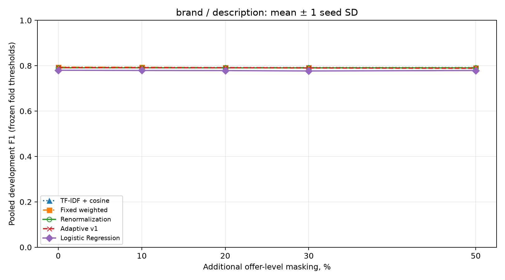
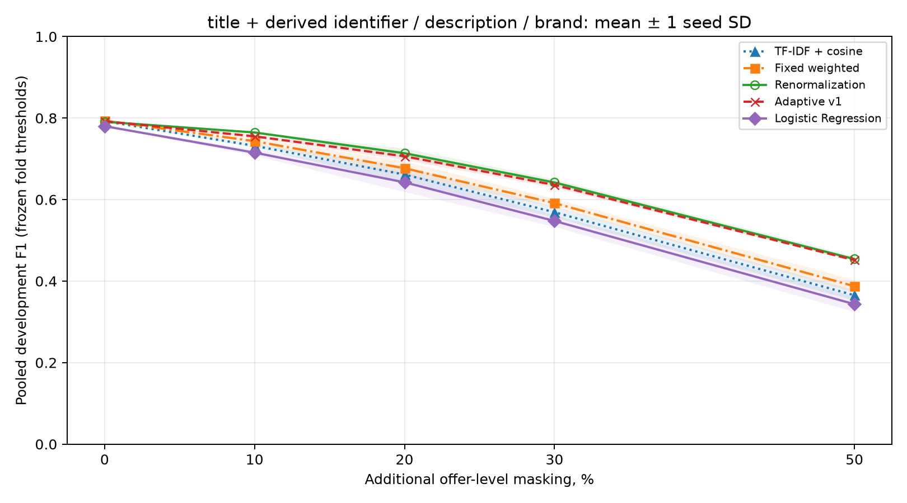

# Development-порівняння відомих методів

Джерело: `development_results.json`. Це вкладена групова перевірка всередині офіційного TRAIN; результати є development-оцінками. Фінальний TEST, попередній REPORT і непідтверджені FPV-мітки не використано.

Метрики обчислено з об’єднаних outer-held-out рішень, а не усередненням F1 окремих fold. Кожна включена пара оцінюється один раз; навчений класифікатор і поріг можуть відрізнятися між fold.

Відкидання негативів між fold змінює class prevalence на кожному рівні:

| Частина | Мінімум позитивів | Максимум позитивів |
| --- | --- | --- |
| Inner fit | 34.4% | 37.1% |
| Outer fit | 27.2% | 27.8% |
| Inner pooled evaluation | 50.2% | 53.2% |
| Outer evaluation | 42.6% | 45.6% |

Refit може змінювати intercept/score scale LR і перенесення внутрішнього порога. Це правдоподібне обмеження, не доведена єдина причина результату; post-hoc корекція не проводилася.

| Метод | Precision | Recall | F1 | TN | FP | FN | TP |
| --- | --- | --- | --- | --- | --- | --- | --- |
| TF-IDF + cosine | 0.6613 | 0.9880 | 0.7923 | 382 | 253 | 6 | 494 |
| Fixed weighted | 0.6667 | 0.9800 | 0.7935 | 390 | 245 | 10 | 490 |
| Renormalization | 0.6631 | 0.9800 | 0.7910 | 386 | 249 | 10 | 490 |
| Adaptive v1 | 0.6649 | 0.9800 | 0.7922 | 388 | 247 | 10 | 490 |
| Logistic Regression | 0.6920 | 0.8940 | 0.7801 | 436 | 199 | 53 | 447 |

Confusion matrix має порядок `[[TN, FP], [FN, TP]]`. Таблиця не визначає єдиного порога або фінального навченого артефакту.

## Параметри, обрані лише у внутрішній development-перевірці

| Outer fold | Метод | Поріг | C | gamma | F1 |
| --- | --- | --- | --- | --- | --- |
| 0 | TF-IDF + cosine | 0.19 | — | — | 0.7933 |
| 0 | Fixed weighted | 0.14 | — | — | 0.7970 |
| 0 | Renormalization | 0.13 | — | — | 0.7971 |
| 0 | Adaptive v1 | 0.14 | — | 0.5 | 0.8010 |
| 0 | Logistic Regression | 0.30 | 0.1 | — | 0.7667 |
| 1 | TF-IDF + cosine | 0.11 | — | — | 0.7749 |
| 1 | Fixed weighted | 0.09 | — | — | 0.7731 |
| 1 | Renormalization | 0.11 | — | — | 0.7749 |
| 1 | Adaptive v1 | 0.13 | — | 1.0 | 0.7749 |
| 1 | Logistic Regression | 0.26 | 0.1 | — | 0.7802 |
| 2 | TF-IDF + cosine | 0.13 | — | — | 0.8100 |
| 2 | Fixed weighted | 0.11 | — | — | 0.8120 |
| 2 | Renormalization | 0.19 | — | — | 0.8020 |
| 2 | Adaptive v1 | 0.19 | — | 0.5 | 0.8020 |
| 2 | Logistic Regression | 0.20 | 1.0 | — | 0.7927 |

## Складні негативні пари

Використано офіційний прапорець складності негативної пари; нижче FPR = FP / (FP + TN). F1 на самій негативній підмножині не є показовою метрикою.

| Метод | Негативи | N | FP | TN | FPR |
| --- | --- | --- | --- | --- | --- |
| TF-IDF + cosine | hard | 296 | 248 | 48 | 0.8378 |
| TF-IDF + cosine | easy | 339 | 5 | 334 | 0.0147 |
| Fixed weighted | hard | 296 | 238 | 58 | 0.8041 |
| Fixed weighted | easy | 339 | 7 | 332 | 0.0206 |
| Renormalization | hard | 296 | 243 | 53 | 0.8209 |
| Renormalization | easy | 339 | 6 | 333 | 0.0177 |
| Adaptive v1 | hard | 296 | 242 | 54 | 0.8176 |
| Adaptive v1 | easy | 339 | 5 | 334 | 0.0147 |
| Logistic Regression | hard | 296 | 199 | 97 | 0.6723 |
| Logistic Regression | easy | 339 | 0 | 339 | 0.0000 |

## Стійкість до додаткових пропусків

Моделі, статистичні перетворення та пороги зафіксовано за чистими навчальними частинами кожного outer fold. На замаскованих даних нічого не перенавчається й не підбирається. Маски однакові для всіх методів і залежать від offer ID; title та похідний identifier приховуються разом.

Значення — середнє ± вибіркове SD за трьома seed; це опис чутливості до штучних масок, не довірчий інтервал і не міждоменна невизначеність. Номінальна частка маскування стосується пропозицій/груп; фактична втрата доступних парних similarities може бути іншою. `effective_removed_fraction` рахує similarity-канали, а не незалежні групи; приховування title може одночасно прибрати два корельовані канали title/identifier.

### Сценарій `auxiliary`

| Метод | 0% | 10% | 20% | 30% | 50% |
| --- | --- | --- | --- | --- | --- |
| TF-IDF + cosine | 0.7923 ± 0.0000 | 0.7923 ± 0.0000 | 0.7923 ± 0.0000 | 0.7923 ± 0.0000 | 0.7923 ± 0.0000 |
| Fixed weighted | 0.7935 ± 0.0000 | 0.7931 ± 0.0007 | 0.7920 ± 0.0007 | 0.7916 ± 0.0018 | 0.7914 ± 0.0008 |
| Renormalization | 0.7910 ± 0.0000 | 0.7910 ± 0.0006 | 0.7905 ± 0.0015 | 0.7905 ± 0.0018 | 0.7903 ± 0.0003 |
| Adaptive v1 | 0.7922 ± 0.0000 | 0.7918 ± 0.0007 | 0.7912 ± 0.0015 | 0.7901 ± 0.0018 | 0.7887 ± 0.0003 |
| Logistic Regression | 0.7801 ± 0.0000 | 0.7791 ± 0.0021 | 0.7787 ± 0.0010 | 0.7769 ± 0.0008 | 0.7791 ± 0.0026 |



### Сценарій `all_groups`

| Метод | 0% | 10% | 20% | 30% | 50% |
| --- | --- | --- | --- | --- | --- |
| TF-IDF + cosine | 0.7923 ± 0.0000 | 0.7320 ± 0.0047 | 0.6614 ± 0.0198 | 0.5690 ± 0.0129 | 0.3653 ± 0.0133 |
| Fixed weighted | 0.7935 ± 0.0000 | 0.7433 ± 0.0074 | 0.6769 ± 0.0168 | 0.5915 ± 0.0106 | 0.3874 ± 0.0155 |
| Renormalization | 0.7910 ± 0.0000 | 0.7646 ± 0.0005 | 0.7138 ± 0.0119 | 0.6420 ± 0.0076 | 0.4542 ± 0.0066 |
| Adaptive v1 | 0.7922 ± 0.0000 | 0.7552 ± 0.0042 | 0.7063 ± 0.0095 | 0.6359 ± 0.0069 | 0.4515 ± 0.0015 |
| Logistic Regression | 0.7801 ± 0.0000 | 0.7152 ± 0.0074 | 0.6424 ± 0.0236 | 0.5476 ± 0.0145 | 0.3434 ± 0.0189 |



### Повна відсутність свідчень за 50% маскування всіх груп

Логістичний baseline за нульового вектора використовує навчений intercept; евристики повертають нуль. Таблиця показує середню за seed кількість таких пар і позитивних рішень серед них; це діагностика поведінки, а не нове правило відсікання.

| Метод | Без усіх свідчень, mean | Позитивних серед них, mean |
| --- | --- | --- |
| TF-IDF + cosine | 703.00 | 0.00 |
| Fixed weighted | 703.00 | 0.00 |
| Renormalization | 703.00 | 0.00 |
| Adaptive v1 | 703.00 | 0.00 |
| Logistic Regression | 703.00 | 0.00 |

## Парні рішення

```json
{
  "renorm_vs_adaptive": {
    "n": 1135,
    "different_decisions": 2,
    "both_correct": 876,
    "both_wrong": 257,
    "first_only_correct": 0,
    "second_only_correct": 2
  },
  "adaptive_vs_logistic": {
    "n": 1135,
    "different_decisions": 91,
    "both_correct": 835,
    "both_wrong": 209,
    "first_only_correct": 43,
    "second_only_correct": 48
  }
}
```

Повні неокруглені значення, split manifests, exclusions, параметри й контрольні суми збережено у JSON/CSV. Порівняння зі старим REPORT не використовується як підтвердження переваги.
