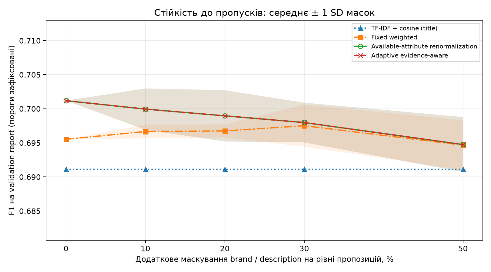
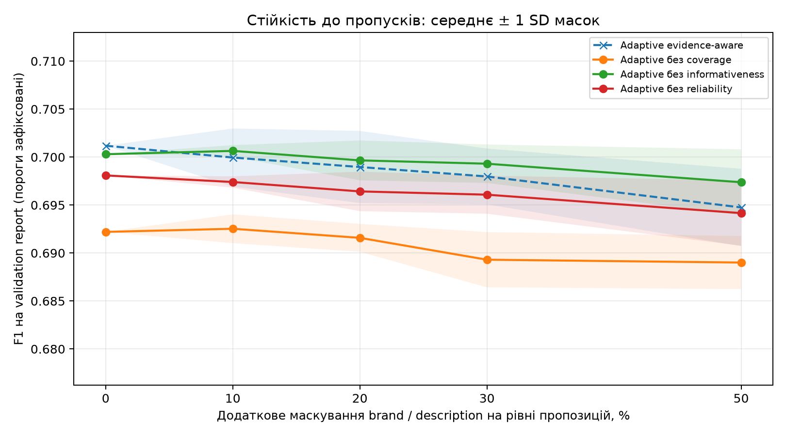

# Попередні валідаційні експерименти

Цей звіт сформовано `report_validation.py` із фактичного JSON запуску `docs/validation/results.json`. Test-метрики тут не обчислюються. Пороги й гіперпараметри обрано лише на tuning-частині validation; clean-метрики нижче та всі маски обчислено на окремій reporting-частині. Product clusters між цими частинами не перетинаються. Це попередня валідаційна перевірка за зафіксованим протоколом, яка не замінює майбутнього фінального тестування.

Докладні формули й протокол наведено в [методиці](experiment_methodology.md), походження validation й перевірки витоку — у [валідаційному аудиті](validation_data_audit.json).

## Дані

| Частина | Пари | Позитивні | Негативні | % позитивних | Пропозиції | Кластери |
| --- | --- | --- | --- | --- | --- | --- |
| Train | 2500 | 500 | 2000 | 20.00% | 1000 | 500 |
| Validation до розділення | 2500 | 500 | 2000 | 20.00% | 1000 | 500 |
| TUNE | 729 | 250 | 479 | 34.29% | 500 | 250 |
| REPORT | 728 | 250 | 478 | 34.34% | 500 | 250 |

## Основне порівняння

TF-IDF та розрізнювальність полів навчаються лише на train. Усі атрибутні методи отримують однакові нормалізовані ознаки; `text` є явно заявленим baseline лише за title. `title` та похідний `identifier` входять до спільної групи свідчень із сумарною базовою вагою 0.70; `description` і `brand` мають по 0.15. Внутрішня нормалізація доступних title/identifier є спільною для всіх атрибутних методів; fixed означає фіксовані ваги між групами. Точні неокруглені числа й параметри збережено в JSON/CSV.

| Метод | Поріг | Precision | Recall | F1 | TN | FP | FN | TP |
| --- | --- | --- | --- | --- | --- | --- | --- | --- |
| text | 0.1000 | 0.5338 | 0.9800 | 0.6911 | 264 | 214 | 5 | 245 |
| fixed | 0.0900 | 0.5440 | 0.9640 | 0.6955 | 276 | 202 | 9 | 241 |
| renorm | 0.1400 | 0.5563 | 0.9480 | 0.7012 | 289 | 189 | 13 | 237 |
| adaptive | 0.1500 | 0.5563 | 0.9480 | 0.7012 | 289 | 189 | 13 | 237 |

Зафіксована причина вибору validation з аудиту (оригінальний запис):

> Official additional 80cc100un/small validation rejected: 110 training offer IDs, 27 training pairs, and 250 training clusters overlap; empirical unseen-cluster fraction is 0.500000; failed checks: ['train__unseen_validation']. Official original seen validation retained verbatim; no rows filtered.

Різниця F1 adaptive мінус comparator на clean reporting: `text`: ΔF1=+0.0101; `fixed`: ΔF1=+0.0057; `renorm`: ΔF1=+0.0000. Ці різниці не є перевіркою статистичної значущості.

**Adaptive не перевершив renorm:** усі наведені clean-метрики й confusion matrix збігаються. Це не підтверджує додаткову корисність адаптивних множників у цьому протоколі; рівність не є доказом еквівалентності формул.

## Розділення tuning / reporting

Вибрану validation small/80cc розділено детерміновано за товарними cluster IDs. Пара з кінцями в різних частинах вилучається, тому кількість негативних пар і баланс класів змінюються. Ці результати не слід безпосередньо зіставляти з опублікованими оцінками на повній офіційній validation. Маски застосовуються тільки до reporting. Ця незалежність tuning від reporting не означає unseen щодо train: режим джерела validation зафіксовано нижче й в окремому аудиті.

Параметри зафіксованого протоколу:

```json
{
  "version": "validation-grouped-evidence-v1",
  "validation_mode": "fallback_seen",
  "representation_fit": "train only, deduplicated offer IDs",
  "informativeness_fit": "train similarities and train labels only",
  "tuning": "clean TUNE partition of validation only",
  "reporting": "disjoint REPORT partition of validation; no retuning",
  "partition": {
    "unit": "product cluster_id",
    "seed": 20261101,
    "tune_fraction": 0.5,
    "assignment": "Sort clusters by SHA256(seed:cluster_id); first floor(fraction*n) -> TUNE",
    "crossing_pairs": "Exclude pairs whose endpoints fall in different partitions; preserve official files.",
    "original_pairs": 2500,
    "tune_clusters": 250,
    "report_clusters": 250,
    "tune_cluster_ids": {
      "count": 250,
      "full_ids": "See results.json"
    },
    "report_cluster_ids": {
      "count": 250,
      "full_ids": "See results.json"
    },
    "tune": {
      "pairs": 729,
      "labels": {
        "0": 479,
        "1": 250
      },
      "unique_offers": 500,
      "unique_clusters": 250,
      "observed_negative_hard_rate": 0.4968684759916493
    },
    "report": {
      "pairs": 728,
      "labels": {
        "0": 478,
        "1": 250
      },
      "unique_offers": 500,
      "unique_clusters": 250,
      "observed_negative_hard_rate": 0.5146443514644351
    },
    "excluded_crossing_pairs": 1043,
    "excluded_labels": {
      "0": 1043,
      "1": 0
    },
    "offer_overlap_tune_report": 0
  },
  "threshold_grid": {
    "count": 99,
    "min": 0.01,
    "max": 0.99,
    "full_grid": "See results.json"
  },
  "selection": "max F1, then precision, then higher threshold; parameter ties retain grid order",
  "gamma_grid": [
    0.5,
    1.0,
    1.5
  ],
  "main_penalty": 0.0,
  "prior_score_reference": 0.2,
  "group_weights": [
    0.7,
    0.15,
    0.15
  ],
  "groups": [
    [
      "title",
      "identifier"
    ],
    [
      "description"
    ],
    [
      "brand"
    ]
  ],
  "group_channel_weights": [
    [
      0.5714285714285714,
      0.42857142857142855
    ],
    [
      1.0
    ],
    [
      1.0
    ]
  ],
  "manual_reliability": [
    1.0,
    1.0,
    1.0,
    0.7
  ],
  "ablation_policy": "Inherit full-model gamma and penalty; reselect only threshold on clean TUNE. Also report removal with the full-model threshold frozen.",
  "legacy_diagnostics": "Original raw-channel scores; legacy adaptive gamma=.5/1/1.5 and penalty=0/.10/.25 grid. Unequal tuning budget; descriptive diagnostics only.",
  "missingness": {
    "rates": [
      0.0,
      0.1,
      0.2,
      0.3,
      0.5
    ],
    "seeds": [
      11,
      22,
      33
    ],
    "attributes": [
      "description",
      "brand"
    ],
    "unit": "offer ID and attribute",
    "mechanism": "SHA256(seed:field:offer_id), independent uniform masking; a pair loses the feature if either offer is masked",
    "thresholds": "Frozen at clean-TUNE values for all REPORT masks"
  },
  "final_test_evaluated": false
}
```

Використано **seen-validation** як зафіксований fallback. Product clusters validation можуть бути присутні в train, хоча offer IDs між train і validation не повторюються. Отже, навіть окремий reporting не оцінює перенесення на unseen товари й не усуває розрив до майбутнього unseen-test.

## Маскування та фіксовані пороги

Маскуються лише `brand` і `description`; `title` та похідний із нього `identifier` збережено. Та сама пропозиція має однакову маску в усіх парах, включно з перестановкою сторін. Маски вкладені за часткою пропусків. Наявні природні пропуски зберігаються. Задана частка є ймовірністю додаткового приховування поля пропозиції; частка втрати порівнюваних полів пари буде іншою. Пороги і параметри clean tuning заморожено для всіх часток; повторного добору за маскованими даними немає.

Перевірені seeds: `11, 22, 33`. У таблиці подано середнє F1 ± вибіркове SD за масками (`ddof=1`); це описова варіація маскування, не довірчий інтервал.

| Метод | 0% | 10% | 20% | 30% | 50% |
| --- | --- | --- | --- | --- | --- |
| text | 0.6911 ± 0.0000 | 0.6911 ± 0.0000 | 0.6911 ± 0.0000 | 0.6911 ± 0.0000 | 0.6911 ± 0.0000 |
| fixed | 0.6955 ± 0.0000 | 0.6967 ± 0.0010 | 0.6967 ± 0.0009 | 0.6975 ± 0.0031 | 0.6947 ± 0.0036 |
| renorm | 0.7012 ± 0.0000 | 0.7000 ± 0.0030 | 0.6990 ± 0.0038 | 0.6980 ± 0.0029 | 0.6947 ± 0.0040 |
| adaptive | 0.7012 ± 0.0000 | 0.7000 ± 0.0030 | 0.6990 ± 0.0038 | 0.6980 ± 0.0029 | 0.6947 ± 0.0040 |

У всіх 15 комбінаціях частка×seed adaptive і renorm мають однакові Precision/Recall/F1 та confusion matrix. Отже цей стрес-тест не показує переваги адаптивного механізму над простим перенормуванням. Рівність агрегованих метрик окремо не доводить рівності індивідуальних передбачень або формул.

Окрема [програмна перевірка](validation/independent_verification.json) підтвердила рівність **індивідуальних рішень** adaptive і renorm у всіх 15 умовах на тих самих REPORT-парах із замороженими параметрами. Оцінки score при цьому різні (максимальна |Δscore|=0.12816). Отже збіг F1 не спричинений випадково однаковими confusion counts, проте за межами цих пар і порогів еквівалентність методів не доведено.

Фактична частка видалених порівнюваних полів пари серед тих brand/description, які були порівнювані до маскування. Один запис на seed, без повторення за методами:

| Задане маскування пропозицій | Видалено полів пари: mean | SD |
| --- | --- | --- |
| 0% | 0.00% | 0.00% |
| 10% | 20.56% | 2.34% |
| 20% | 34.79% | 2.28% |
| 30% | 49.02% | 1.55% |
| 50% | 74.26% | 3.07% |



Вертикальну вісь графіків звужено до виміряного діапазону для читабельності малих змін. Різні типи ліній і маркерів показують криві, які накладаються; смуги ±SD не є CI.

0% означає відсутність штучного маскування, а не повні атрибути. Три seeds при 0% дають ту саму clean reporting-вибірку й не є трьома незалежними експериментами.

## Абляції

| Метод | Поріг | Precision | Recall | F1 | TN | FP | FN | TP |
| --- | --- | --- | --- | --- | --- | --- | --- | --- |
| adaptive_no_coverage | 0.0900 | 0.5363 | 0.9760 | 0.6922 | 267 | 211 | 6 | 244 |
| adaptive_no_info | 0.1600 | 0.5566 | 0.9440 | 0.7003 | 290 | 188 | 14 | 236 |
| adaptive_no_reliability | 0.1300 | 0.5524 | 0.9480 | 0.6981 | 286 | 192 | 13 | 237 |

Абляції вимикають один механізм адаптивного методу. Інші гіперпараметри успадковуються від повної моделі. Якщо для абляції окремо обрано clean-поріг, її оцінка характеризує вилучення компонента з повторним добором робочої точки. Порівняння з порогом повної моделі слід читати окремо як зміну поведінки у фіксованій точці.



`no_reliability` перевіряє чутливість до вручну заданих множників, а не доводить реальну надійність джерел. У WDC немає gold confidence/позначок достовірності полів. Reliability та informativeness входять до ваг лише через добуток q_i=r_i·d_i. Окремі програмні перемикачі дозволяють перевірити вплив заданих множників, але не ідентифікують справжню надійність незалежно від розрізнювальності без зовнішньої розмітки. У головному методі penalty=0: identifier-конфлікт уже впливає на similarity відповідної групи. Окремий `no_penalty` дублював би головний метод, тому не додається.

Абляції на reporting із тим самим порогом повної adaptive-моделі (параметри успадковано, threshold не переналаштовано):

| Метод | Поріг | Precision | Recall | F1 | TN | FP | FN | TP |
| --- | --- | --- | --- | --- | --- | --- | --- | --- |
| adaptive_no_coverage | 0.1500 | 0.5590 | 0.9480 | 0.7033 | 291 | 187 | 13 | 237 |
| adaptive_no_info | 0.1500 | 0.5548 | 0.9520 | 0.7010 | 287 | 191 | 12 | 238 |
| adaptive_no_reliability | 0.1500 | 0.5606 | 0.9440 | 0.7034 | 293 | 185 | 14 | 236 |

За незмінного порога вилучення компонента дає вищий reporting F1 для `adaptive_no_coverage` (ΔF1=+0.0021), `adaptive_no_reliability` (ΔF1=+0.0022). Отже висновок про корисність компонентів залежить від політики переналаштування порога; табличні різниці з окремим tuning-порогом не доводять незалежного внеску надійності чи coverage. Ці параметри не змінюються за результатами reporting.

## Допоміжна діагностика початкового методу

| Метод | Поріг | Precision | Recall | F1 | TN | FP | FN | TP |
| --- | --- | --- | --- | --- | --- | --- | --- | --- |
| legacy_fixed | 0.0600 | 0.5342 | 0.9680 | 0.6885 | 267 | 211 | 8 | 242 |
| legacy_renorm | 0.1000 | 0.5400 | 0.9720 | 0.6943 | 271 | 207 | 7 | 243 |
| legacy_adaptive | 0.1800 | 0.5771 | 0.8680 | 0.6933 | 319 | 159 | 33 | 217 |

Це збережені початкові raw-channel формули без нового спільного групування. У legacy adaptive сітка включає і gamma, і penalty, отже бюджет добору параметрів більший. Ця таблиця потрібна для прозорості: різниця з головними методами не ізолює один компонент і не є доказом переваги групування.

## Розрізнювальність, оцінена лише на train

| Канал | d | n позитивних | mean similarity + | n негативних | mean similarity − |
| --- | --- | --- | --- | --- | --- |
| title | 1.0567 | 500 | 0.4716 | 2000 | 0.1932 |
| description | 0.8109 | 288 | 0.3175 | 1154 | 0.1620 |
| brand | 1.5000 | 67 | 0.8955 | 282 | 0.3759 |
| identifier | 1.4083 | 204 | 0.5110 | 704 | 0.0569 |

Статистики рахуються лише серед доступних порівнянь відповідного класу. Різна заповненість за класами й повторення пропозицій обмежують трактування d.

Фактор brand=1.5000 оцінено лише за 67 доступними позитивними й 282 негативними навчальними порівняннями. Така вибірка серед доступних значень може бути нерепрезентативною; високий d не означає високу достовірність бренду або надійність вебджерела.

## Парні зміни помилок на clean reporting

| comparator | both_correct | both_wrong | adaptive_only_correct | comparator_only_correct | rescued_fp | rescued_fn | introduced_fp | introduced_fn |
| --- | --- | --- | --- | --- | --- | --- | --- | --- |
| text | 500 | 193 | 26 | 9 | 25 | 1 | 0 | 9 |
| fixed | 513 | 198 | 13 | 4 | 13 | 0 | 0 | 4 |
| renorm | 526 | 202 | 0 | 0 | 0 | 0 | 0 | 0 |
| legacy_adaptive | 504 | 170 | 22 | 32 | 2 | 20 | 32 | 0 |

`rescued_fp/fn` — помилки comparator, виправлені adaptive; `introduced_fp/fn` — помилки adaptive, яких не було в comparator. Це парне порівняння однакових рядків за обраними на tuning для методів clean-порогами; воно описує рух рішень, а не причинний внесок окремого множника. Повторення пропозицій у парах порушує незалежність спостережень.

## Діагностика за свідченнями

| Прошарок | Метод | n | Позитивні | F1 | FP | FN |
| --- | --- | --- | --- | --- | --- | --- |
| coverage_0.70 | text | 253 | 93 | 0.7309 | 65 | 2 |
| coverage_0.70 | fixed | 253 | 93 | 0.7288 | 57 | 7 |
| coverage_0.70 | renorm | 253 | 93 | 0.7350 | 55 | 7 |
| coverage_0.70 | adaptive | 253 | 93 | 0.7350 | 55 | 7 |
| coverage_0.85 | text | 423 | 140 | 0.6732 | 132 | 2 |
| coverage_0.85 | fixed | 423 | 140 | 0.6781 | 129 | 2 |
| coverage_0.85 | renorm | 423 | 140 | 0.6837 | 118 | 6 |
| coverage_0.85 | adaptive | 423 | 140 | 0.6837 | 118 | 6 |
| coverage_1.00 | text | 52 | 17 | 0.6400 | 17 | 1 |
| coverage_1.00 | fixed | 52 | 17 | 0.6800 | 16 | 0 |
| coverage_1.00 | renorm | 52 | 17 | 0.6800 | 16 | 0 |
| coverage_1.00 | adaptive | 52 | 17 | 0.6800 | 16 | 0 |
| identifier_conflict | text | 178 | 36 | 0.4853 | 67 | 3 |
| identifier_conflict | fixed | 178 | 36 | 0.4918 | 56 | 6 |
| identifier_conflict | renorm | 178 | 36 | 0.4685 | 49 | 10 |
| identifier_conflict | adaptive | 178 | 36 | 0.4685 | 49 | 10 |
| identifier_missing | text | 489 | 169 | 0.7152 | 131 | 2 |
| identifier_missing | fixed | 489 | 169 | 0.7140 | 130 | 3 |
| identifier_missing | renorm | 489 | 169 | 0.7233 | 124 | 3 |
| identifier_missing | adaptive | 489 | 169 | 0.7233 | 124 | 3 |

Coverage-прошарки утворюють розбиття за доступністю груп; identifier-conflict і identifier-missing можуть перетинатися з ними. Числа таких прошарків не можна складати. Усередині постійного coverage shrinkage є афінним перетворенням score: рух помилок за спільним порогом не доводить покращення ранжування.

Для обраних γ=0.50, τ=0.1500, π=0.2000 правило A≥τ еквівалентне H≥(τ−(1−C^γ)π)/C^γ (C>0, penalty=0). Це алгебраїчне пояснення робочої точки, а не новий добір параметрів:

| Coverage C | Пар | Ефективний поріг H |
| --- | --- | --- |
| 0.70 | 253 | 0.14024 |
| 0.85 | 423 | 0.14577 |
| 1.00 | 52 | 0.15000 |

Оскільки π>τ, нижча coverage **полегшує прийняття позитивного рішення** відносно незмінного H-порога τ. Цю опорну точку не слід називати «консервативним prior». До фінального оцінювання потрібно погодити зміст shrinkage та калібрування шкали/порога. Якщо очікується лише зниження впевненості за неповноти, можливу зміну формули або допустимої опорної точки слід обґрунтувати, зафіксувати до нового незалежного валідаційного досліду й не підбирати за поточним REPORT чи test.

Серед 178 пар із нульовим identifier Jaccard є 36 позитивних за WDC labels; у цьому прошарку adaptive має FN=10. Нульовий евристичний Jaccard не є достовірною суперечністю товарної моделі. Це обґрунтовує ручний аудит extractor на train/validation перед посиленням identifier-конфліктів, без висновку про помилковість конкретних WDC labels.

## Обмеження та рішення до фінального оцінювання

1. Це результати на офіційних готових парах; вони не вимірюють повноту генерації кандидатів або end-to-end пошуку. Результатів на окремих технічних FPV-атрибутах цей WDC не дає.
2. `identifier` евристично походить із title, тому ці два канали корельовані. Навіть спільна група свідчень не робить ознаки незалежними. Coverage є часткою доступних базових групових бюджетів, а не каліброваною ймовірністю достатності доказів.
3. Інформативність тут означає train-різницю середніх similarity для класів, а не інформацію конкретного значення. Вручну задані reliability не можна називати емпірично доведеними.
4. Незалежне маскування двох полів — контрольований MCAR стрес-тест, який не відтворює всі природні, залежні від товару чи вебджерела пропуски. Загальний score не є ймовірністю збігу.
5. Потрібно погодити формулу, параметри й протокол перед окремим фінальним тестуванням. Нижчий validation F1 сам по собі не є підставою довільно змінювати метод; виправлення мають спиратися на аналіз кореляції, coverage і руху FP/FN та вимагатимуть нової незалежної перевірки. Наукову новизну й перевагу не доведено.

Повторна перевірка з навчанням представлень тільки на train й незмінними конфігураціями відтворила ручний підрахунок TN/FP/FN/TP та Precision/Recall/F1 для 10/10 clean-методів. Це перевірка експорту й обчислень, не нова статистично незалежна вибірка. Sidecar зв'язаний із точними байтами results.json через SHA256.

Обмеження, зафіксовані під час запуску:

- Seen-model fallback validation cannot establish generalization to reserved unseen-model test.
- Cluster-disjoint TUNE/REPORT discard crossing negative pairs, change class prevalence and difficulty; not directly comparable to official full-split benchmark scores.
- Single deterministic partition; no generalization confidence interval or proof of superiority.
- Reliability coefficients are manual sensitivity assumptions, not empirically validated source reliability.
- Informativeness is global field discriminativeness, not value-specific information content.
- Title and identifier remain correlated views of the same source even inside a shared budget.
- Only description and brand are masked; seed standard deviations describe masks, not sampling uncertainty.
- Metrics classify supplied pairs and do not measure end-to-end retrieval recall.

## Артефакти та відтворення

Джерело: [results.json](validation/results.json); [reporting CSV](validation/metrics.csv), [tuning CSV](validation/tuning_metrics.csv), [усі маски CSV](validation/missingness.csv), [агрегація CSV](validation/missingness_summary.csv). PNG і SVG містять ті самі криві. Для відтворення звіту з готового JSON:

```powershell
.\.venv\Scripts\python.exe -X utf8 report_validation.py --results docs/validation/results.json --out-dir docs/validation --report docs/validation_results.md
```
